# Architecture overview

The pipeline starts with approved inputs and ends with independently reviewed
release evidence. Arrows show artifact dependencies,not a claim that a later
training stage improves accuracy.

[Editable Mermaid source](diagrams/architecture.mmd). The checked-in SVG is rendered
from that source;the site does not need a diagram CDN at runtime.

## Original decoder

[Editable Mermaid source](diagrams/decoder.mmd). Read the exact
[block equations](reference/docs/model.md) and [architecture RFC](reference/docs/research/architecture_rfc.md).
The RFC selected dense GQA rather than pretending to implement MLA or MoE.

## Interfaces and trust boundaries

| Boundary | Contract | Evidence |
| --- | --- | --- |
| Source to dataset | Rights,usage policy,hashes,family splits | Data card;data pipeline tests |
| Dataset to model | Actual vocab,positions,document/loss masks | PackedDataset;packing property tests |
| Checkpoint to resume | Config/source/library/RNG/cursor identity | Atomic replay and DCP tests |
| Checkpoint to eval | Read-only native weights,bounded verifiers | Native receipts and regression tests |
| Model to engine | Private KV/RNG,bounded token requests | Cached/full/stream reference tests |
| Engine to HTTP | Auth,body/admission limits,JSON/SSE | Actual FastAPI and loopback tests |
| Artifact to release | Rights,contamination,quality,safety review | Responsible-release gates |

Only trusted cluster ranks may join a distributed training group. Hashes detect
corruption;they do not authenticate an unknown publisher. Portable model weights
are safetensors. Training-state loads use restricted metadata and weights-only
tensor/optimizer deserialization;see the [security review](security.md).
